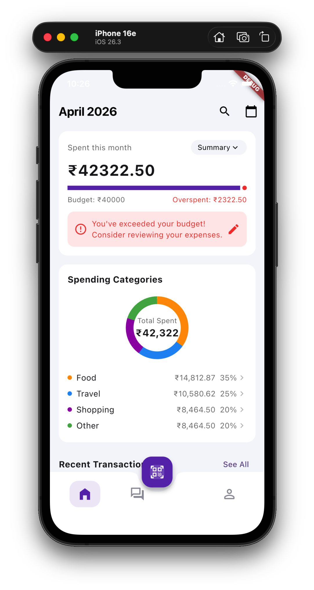
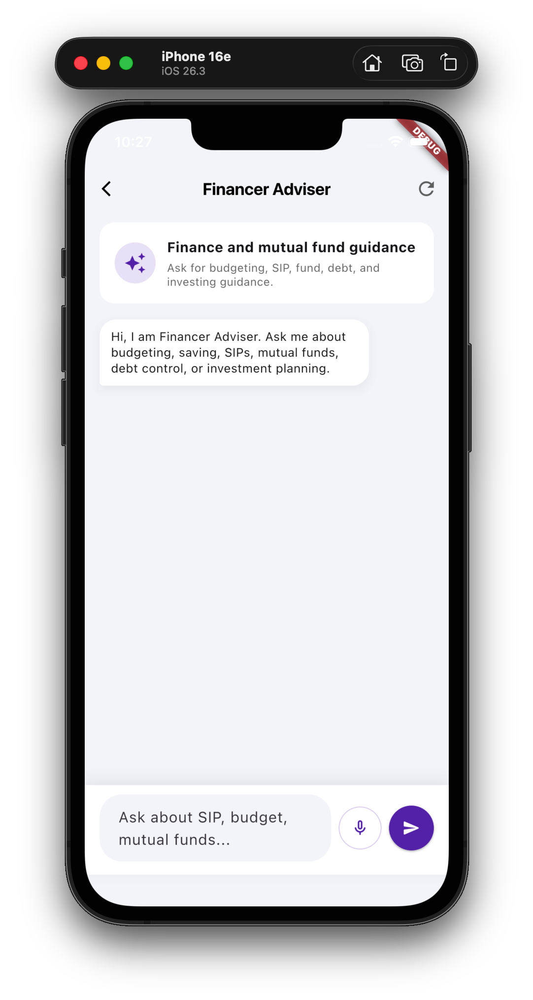
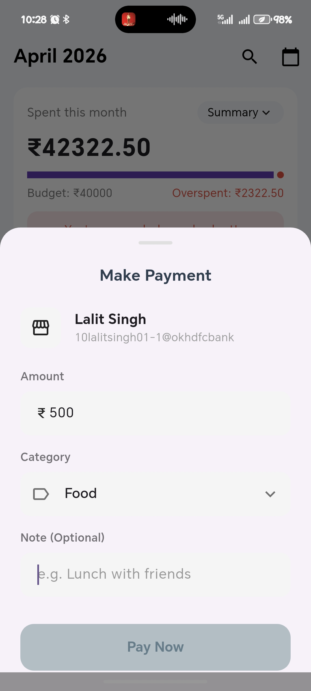
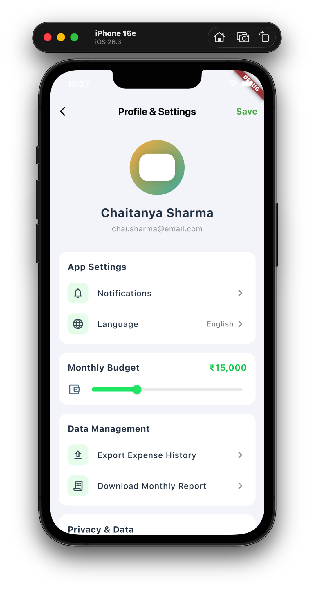

# ExpenseEye

<p align="center">
  
</p>

<h3 align="center"><b>A multilingual expense tracker with QR payments, voice-enabled AI chat, and a clean personal finance dashboard.</b></h3>

<p align="center">
  
  
  
  
</p>

<p align="center"><i>Track it. Pay it. Ask it.</i></p>

---

## Why ExpenseEye

**ExpenseEye** brings **expense tracking**, **UPI QR payments**, and an **AI finance assistant** into one mobile flow.

- **live monthly spend view**
- **category breakdown**
- **voice + text finance chat**
- **multilingual app experience**
- **fast QR payment handoff**

> [!TIP]
> **Best fit:** users who want a simple finance app that feels practical, modern, and quick to use every day.

## Feature Snapshot

| Feature | What it does |
|---|---|
| **Dashboard** | Shows monthly spend, budget status, and category insights |
| **Financer Adviser** | Gives short finance guidance for budgeting, SIPs, debt, and planning |
| **Voice Chat** | Converts speech into text in the selected app language |
| **QR Payments** | Scans UPI QR codes and moves users into payment flow faster |
| **Language Settings** | Switches the app between **English**, **Hindi**, and **Marathi** |

---

## Experience Tour

### Home Dashboard

| Preview | Description |
|---|---|
|  | **The home screen is the control center.** It gives a quick view of the month, total spending, budget status, category split, and recent transactions. The bottom navigation keeps **Home**, **Chat**, **Profile**, and **QR actions** close at hand. |

**What stands out**

- **budget tracking** with overspend feedback
- **category chart** for spending clarity
- **quick access navigation**

### Financer Adviser

| Description | Preview |
|---|---|
| **Financer Adviser** is the in-app finance assistant. It replies in the **selected app language**, supports **voice input**, and keeps advice **short, clear, and practical**. It is built for **budgeting**, **SIP questions**, **mutual fund guidance**, **debt understanding**, and **personal finance planning**. |  |

**Why the bot is useful**

- **asks and answers in the selected language**
- **keeps advice concise**
- **supports voice-based finance questions**
- **fits naturally into the expense workflow**

### QR Payment Flow

| Preview | Description |
|---|---|
|  | **The QR flow is built for speed.** Users tap the center QR action, scan a UPI code, review merchant and amount details, choose a category, add a note if needed, and continue through supported UPI apps. It connects **payment** and **expense tracking** in one action. |

**Flow**

1. **Tap** the center QR button  
2. **Scan** the UPI QR code  
3. **Review** merchant and amount  
4. **Choose** expense category  
5. **Continue** to a supported UPI app  

### Profile & Settings

| Description | Preview |
|---|---|
| The profile screen keeps user preferences organized. It includes **notifications**, **language selection**, **budget controls**, **data options**, and **privacy settings**. This is where the app-wide language changes, and the chatbot follows that choice automatically. |  |

---

## Multilingual Experience

ExpenseEye supports:

- **English**
- **Hindi**
- **Marathi**

When the language changes, the app updates:

- **dashboard labels**
- **settings text**
- **chatbot UI**
- **chatbot responses**
- **voice transcription language**

> [!NOTE]
> The chatbot and voice transcription follow the **same selected app language**, so the experience stays consistent.

## Voice + AI Flow

The assistant supports **voice-first finance questions** inside the same conversation flow.

1. **Tap** the mic icon  
2. **Grant** microphone access  
3. **Speak** the finance question  
4. **Speechmatics** transcribes it in the selected language  
5. The text is **auto-sent** to **Financer Adviser**  
6. The bot replies back in that **same language**  

---

## Built With

- **Flutter**
- **Dart**
- **Groq API**
- **Speechmatics API**
- `permission_handler`
- `record`
- `path_provider`
- `qr_code_scanner_plus`
- `upi_pay`

## Project Structure

```text
lib/
  app_language.dart
  main.dart
  screens/
    create_account_screen.dart
    finance_adviser_chat_screen.dart
    home_screen.dart
    profile_settings_screen.dart
    transactions_screen.dart
  widgets/
    upi_payment_button.dart

ReadmeImages/
  home.png
  bot.png
  profile.png
  qr_payment.jpg
```

## Run Locally

```bash
flutter pub get
flutter run
```

## Build APK

```bash
flutter build apk
```

APK output:

```bash
build/app/outputs/flutter-apk/app-release.apk
```

## Environment Setup

Create a local `.env` file from `.env.example` and add your API keys before running AI and voice features.

---

## Closing Note

**ExpenseEye** is designed to feel simple on the surface while covering the most useful finance actions in one place: **tracking**, **paying**, **asking**, and **understanding**.
